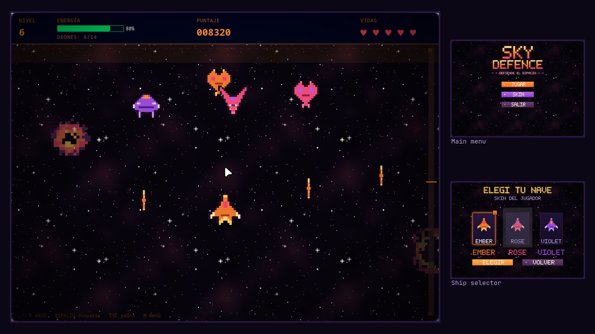

# ☁️ SkyDefence

> A Java arcade space shooter developed as a collaborative university project focused on Object-Oriented Programming and software design.

<p align="center">
  
  <br>
  <sub><i>Gameplay on level 6, main menu and ship selector.</i></sub>
</p>

## 📖 About

**SkyDefence** is an arcade space shooter built with **Java Swing** as part of a university course project.

The project was created collaboratively to apply fundamental **Object-Oriented Programming (OOP)** concepts in a complete interactive application. The development process involved designing game entities, implementing their behavior, managing interactions between objects, and organizing the project into a structured and maintainable codebase.

The main goal was to combine programming concepts learned throughout the course into a functional game while gaining practical experience working as part of a development team.

## 🎮 Gameplay

You pilot a fighter that defends the sky from waves of enemy drones:

* Drone squadrons cross the screen from left to right and right to left, firing missiles that explode in the air. The closer a missile explodes to you, the more energy it drains: a direct hit costs a life, running out of energy costs a life, and dodging a missile earns points.
* Shoot the drones down to score points. Clearing a squadron completes the level.
* Every level the drones and missiles get faster, and every 5 levels the squadrons get bigger.
* Every 10 levels a **boss** appears, backed by five waves of drones.
* You start with 3 lives and earn an extra one every 1,000 points (up to 5).
* Before playing you can pick one of three ship skins: **Ember**, **Rose** or **Violet**.

### Controls

| Key | Action |
|---|---|
| `←` `→` / `A` `D` | Move left and right |
| `↑` `↓` / `W` `S` | Climb and descend |
| `Space` | Shoot |
| `Esc` | Pause |
| `M` (while paused) | Back to the main menu |
| `Enter` | Skip the level transition |

The game is built around interactions between different game objects, allowing concepts such as inheritance, encapsulation, polymorphism, and object composition to be applied in a practical environment.

## ✨ Features

* 🚀 Arcade shoot 'em up gameplay with increasing difficulty
* 👾 Drones, missiles, a boss fight and explosion effects
* 🎨 Three selectable ship skins and pixel-art assets
* 🧩 Object-Oriented Programming architecture
* 🏗️ Modular project structure
* 🎮 Interactive graphical interface
* 🧪 Dedicated testing components
* 🤝 Collaborative development workflow

## 🛠️ Technologies

* **Java** (Swing)
* **Object-Oriented Programming (OOP)**
* **IntelliJ IDEA**
* **Git**
* **GitHub**

## 🧠 OOP Concepts

One of the main objectives of the project was to put Object-Oriented Programming principles into practice.

The project makes use of concepts such as:

* **Encapsulation** — organizing data and behavior within dedicated classes.
* **Inheritance** — creating specialized objects based on common entities.
* **Polymorphism** — allowing different objects to implement or behave through shared abstractions.
* **Abstraction** — defining common behaviors and structures for game entities.
* **Composition** — building more complex game systems through interactions between objects.

## 📂 Project Structure

```text
SkyDefence/
├── src/
│   ├── assets/
│   ├── interfas/
│   ├── skydefense/
│   └── Test/
├── .idea/
├── .gitignore
├── EXPLICACION_CODIGO.txt
└── POO-Objetos.iml
```

## 🚀 Getting Started

### Prerequisites

Make sure you have installed:

* Java JDK
* IntelliJ IDEA or another Java-compatible IDE
* Git

### Clone the repository

```bash
git clone https://github.com/But0o/SkyDefence.git
cd SkyDefence
```

Open the project with IntelliJ IDEA and run `interfas.PantallaInicio`.

To run it from the terminal instead:

```bash
javac -d out $(find src/skydefense src/interfas -name '*.java')
cp -r src/assets out/
java -cp out interfas.PantallaInicio
```

## 👥 Team Project

SkyDefence was developed as a **team-based university project**.

The project provided practical experience with:

* Collaborative software development
* Git and GitHub workflows
* Object-oriented software design
* Code organization
* Testing and debugging
* Integrating different parts of a shared codebase

## 🎓 Academic Context

This project was developed for a university course focused on **Object-Oriented Programming and software development**.

Its purpose was to demonstrate the practical application of programming principles and software design techniques through the development of a complete Java application.

## 📌 Project Status

**Academic project — completed.**

The repository is maintained primarily as part of my academic portfolio and to demonstrate practical experience with Java, OOP, Git, and collaborative development.

---

**Developed as a university team project.**
